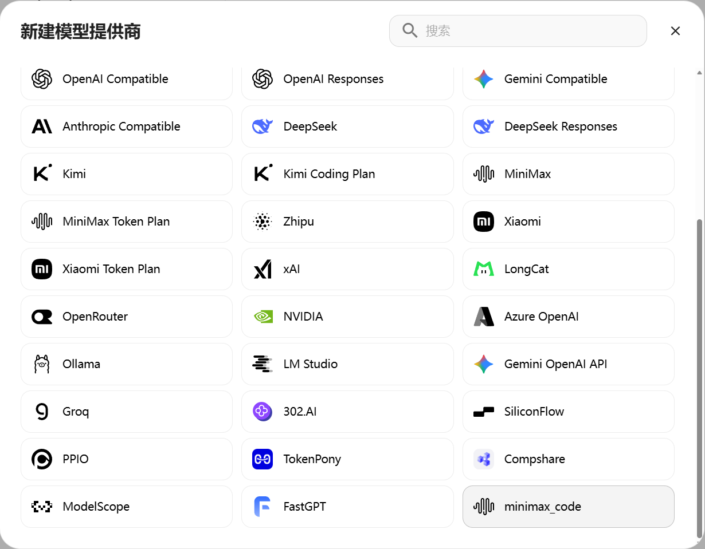

# MiniMax 多模态工具

让你的 AstrBot 机器人用上 MiniMax：画图、做视频、文字转语音、语音转文字、联网搜索、看图、搜图、写音乐和音效，还能查额度。

> [!TIP]
> 音乐和音效现在走 MiniMax Agent 接口（不是已关闭的开放平台音乐服务），建议先 `/mmx login` 登录再用。翻唱功能和旧的后台任务工具已不再提供。

## 快速开始

1. **安装插件**
   - 方式一：在 AstrBot 插件市场搜索「MiniMax 多模态工具」，点击安装。
   - 方式二：插件界面右下角加号 → 从链接安装，输入：
     ```
     https://github.com/piexian/astrbot_plugin_mmx_cli_tool
     ```
2. **准备凭据**（两种方式，选一种就行）：
   - **（推荐）登录账号**：管理员发送 `/mmx login`，按提示选择区域并打开链接授权。登录成功后，插件会自动获取 API Key，图片、视频、语音等功能直接可用，不用再手动填写；搜图、音乐、MiniMax Code 对话、签到也一并解锁。如果登录后提示「未能自动获取 API Key」，改用下面的方式自己填。
   - **自己填写 API Key**：到 [MiniMax Token Plan（国内站）](https://platform.minimaxi.com/user-center/payment/token-plan) 获取 Key，填进插件配置的 `api_key`。同时把 `region` 选成 Key 所属的网站：`cn` 是国内站，`global` 是国际站。
3. **试一试**：发送 `/mmx image 一只戴帽子的猫`，稍等片刻就能收到图片。

运行要求：AstrBot 4.26.0 及以上（「MCode 工作台」需要；更低版本只能用聊天指令和 AI 工具），Python 依赖 httpx 0.27.0 及以上。

## 需要准备什么

| 功能 | 只填了 API Key | 只登录了账号（`/mmx login`） |
|------|:------:|:------:|
| 图片、视频、语音合成、语音转文字、联网搜索、看图、文件管理、额度查询 | 可以用 | 可以用（登录后自动获取 API Key） |
| 搜图、以图搜图、AI 音乐、AI 音效 | 没登录时用它顶替，但服务器可能不认，会提示你去登录 | 建议登录，最稳 |
| MiniMax Code 对话、签到、积分查询 | 用不了 | 必须登录 |

既没填 API Key 也没登录时，第一行的功能都用不了；没登录时，最后一行的功能会提示你先 `/mmx login`。

两种都有时，以配置里填的 `api_key` 为准，登录不会覆盖它。

登录后自动获取的 API Key：

- 保存在插件数据目录里的 `open_api_key.json`（Linux/macOS 上只有运行 AstrBot 的用户能读写），相当于密码，不要发给别人。
- 请求区域跟随你登录时选的区域，不看配置里的 `region`。
- 重新登录（`/mmx login`）会重新获取一次；退出登录（`/mmx logout`）会把它一并删除。
- 如果它哪天失效了（比如图片、视频一直提示 Key 无效），再发送一次 `/mmx login` 即可。

## 功能一览

AI 在对话中可以自动调用下面 17 个工具。

| 工具 | 作用 | 使用条件 |
|------|------|------|
| `mmx_generate_image` | 按文字描述画图，支持比例、角色参考等；图片先存到本地再发送 | 所有人 |
| `mmx_generate_video` | 按文字描述（可加首尾帧）生成视频，等生成完再存到本地发送 | 所有人 |
| `mmx_video_task_get` | 查询视频任务的进度 | 所有人 |
| `mmx_video_download` | 用文件 ID 把做好的视频下载到本地 | 所有人 |
| `mmx_file_upload` | 把插件数据目录或 AstrBot 临时目录里的文件传到 MiniMax 存储 | 仅管理员 |
| `mmx_file_list` | 列出已传到 MiniMax 存储的文件 | 仅管理员 |
| `mmx_file_delete` | 删除已传到 MiniMax 存储的文件 | 仅管理员 |
| `mmx_speech_synthesize` | 文字转语音，可调音色、语速、音量、音高 | 所有人 |
| `mmx_speech_voices` | 查看可用的音色 | 所有人 |
| `mmx_speech_transcribe` | 语音转文字，可区分说话人、带时间戳，也能生成 SRT/WebVTT 字幕 | 所有人 |
| `mmx_web_search` | 联网搜索 | 所有人 |
| `mmx_describe_image` | 看图说话，描述或分析图片内容 | 所有人 |
| `mmx_check_quota` | 查询 API 剩余额度 | 所有人 |
| `mmx_search_images` | 搜图：找真实的网络图片并存到本地 | 建议登录¹ |
| `mmx_image_reverse_search` | 以图搜图：找图片出处和相似网页，返回前 3 条 | 建议登录¹ |
| `mmx_generate_music` | 生成音乐，可带歌词，格式 mp3 或 wav | 建议登录¹ |
| `mmx_generate_sound_effect` | 生成音效 | 建议登录¹ |

¹ 这四项优先使用你 `/mmx login` 登录的账号；没登录时会改用 API Key，但服务器不接受时会提示你先登录。

## 指令用法

在聊天里发送 `/mmx` 开头的指令，不用经过 AI。标注「管理员」的只有管理员能用，标注「需登录」的要先 `/mmx login`。每条指令的全部参数、取值范围和示例见 [完整指令与参数说明](docs/commands.md)。

### 图片
画图。可以加 `--aspect-ratio 16:9` 指定比例，用 `--subject-ref` 参考某张图里的人物。
已登录 MiniMax Code 时走桌面网关的 H3 Image（可加 `--resolution 2K` 选 1K/2K/4K，消耗账号图片额度）；
仅用 API Key 时走开放平台 image-01 系列，此时 `--resolution` 会报错；指定 `--model`、
自定义宽高、`--seed`、加水印或关闭提示词优化也会切到开放平台。路由在提交请求前决定，不自动换路重试。

```
/mmx image 一只戴帽子的猫，水彩风格 --aspect-ratio 1:1
```

### 视频

生成视频。生成需要一些时间，默认会等做完再发送；加 `--no-wait` 则提交后马上返回任务编号。想用一张图当起始画面，加 `--first-frame` 并在消息里附带或引用图片。

```
/mmx video 海边日落，海浪轻轻拍打
/mmx video 让图里的人挥手 --first-frame   # 同时附带或引用一张图片
```

### 语音合成

把文字读出来。

```
/mmx speech 欢迎使用 MiniMax 语音合成 --speed 1.1
```

### 语音转文字

把音频转成文字。可以用 `--file` 指定文件，也可以不写，直接附带或引用一段语音。

```
/mmx speech transcribe --language zh
```

### 搜索与识图

```
/mmx search 今天天气怎么样         # 联网搜索
/mmx vision 描述这张图片里有什么     # 看图说话，需要附带或引用图片
/mmx search-image 柴犬 --n 3        # 搜图并发送，--n 为张数（1-5，默认 3）
/mmx reverse-image                 # 以图搜图，附带或引用图片，或在后面写图片链接
```

### 音乐与音效

```
/mmx music 轻快的夏日民谣 --lyrics 歌词内容 --format mp3
/mmx sfx 雨天打雷的声音
```

生成可能要几分钟。格式只支持 `mp3` 和 `wav`（音效固定为 mp3）。建议先登录。

### 账号与签到

```
/mmx login     # 登录 MiniMax 账号，并自动获取 API Key（管理员）
/mmx logout    # 退出登录（管理员）
/mmx signin    # 领取今天的签到积分（管理员，需登录）
/mmx usage     # 查看积分、套餐余量和签到进度（管理员，需登录）
```

### 文件与额度

```
/mmx file upload --file <路径>   # 上传文件（管理员）
/mmx file list                   # 列出已上传的文件（管理员）
/mmx file delete --file-id <id>  # 删除文件（管理员）
/mmx quota                       # 查看额度，Key 多时每页显示 3 个
/mmx quota 2                     # 只看第 2 个 Key
/mmx quota page 2                # 翻到第 2 页
```

上传文件时，路径只能指向插件数据目录或 AstrBot 临时目录里的文件。

更多参数（如图片的比例与尺寸、语音的音色与格式、视频的首尾帧与时长、转写的字幕格式等）的写法、取值范围和默认值，见 [完整指令与参数说明](docs/commands.md)。

## 在对话中使用

直接跟 AI 说话就行，需要时它会自己调用工具。比如你说「帮我把这段话合成语音：你好」，它就会调用 `mmx_speech_synthesize`，把语音发给你。

生成的图片、视频等会先下载成本地文件再发送，因为远程链接可能过期，或者接收端打不开。

## MiniMax Code 对话与签到

先 `/mmx login` 登录，再在会话或 Agent 设置中选择 MiniMax Code 模型。对话走官方通道（`agent.minimax.cn` / `agent.minimax.io`），消耗订阅额度与签到积分；区域跟随登录，令牌到期自动刷新。

提供商源二选一（提供商源就是 AstrBot「模型供应商」页里的一个供应商配置）：

- **自动（默认）**：`auto_create_provider_source` 开启时，插件创建 `mmx_minimax_code`，附带 `MiniMax-M3.1-Flash`、`MiniMax-M3` 两个模型。
- **手动**：关闭该开关，自己在 WebUI 里添加：进入「模型供应商」页，点右上角「新增供应商」，在弹出的「新建模型提供商」窗口里选择 `minimax_code`（列表的最后一项），再添加模型。



源里的 API Base URL 和 API Key 是占位符，无需填写。「获取模型列表」可拉取云端模型目录，上下文窗口默认 512K。若 `mmx_minimax_code` 已被其他类型的源占用，插件不会覆盖，会在工作台提示并改为运行时注册。

> [!WARNING]
> 卸载插件前，请先删除所有 MiniMax Code 类型的提供商源及其模型，否则 AstrBot 重启时会报找不到 `minimax_code` 适配器。


签到和积分：

```
/mmx signin    # 领取今天的签到积分，每天只能领一次
/mmx usage     # 查看积分余额、明细、套餐余量和签到进度
```

两个指令都只有管理员能用，并且要先登录。想自动签到，打开配置项 `auto_signin`，插件会每 30 分钟检查一次并领取当天的积分。

## MCode 工作台

在 AstrBot 管理面板里直接使用本插件的界面：管理面板 → 插件 → 「MiniMax 多模态工具」→ 视图「MCode 工作台」。

| 面板 | 能做什么 |
|------|----------|
| 顶部状态栏 | 看当前区域、凭据、模型，并选择推理强度档位（对 MiniMax-M3.1-Flash 生效，保存到配置项 `thinking_effort`） |
| 额度侧栏 | 查看额度和账户余额，多个 Key 会合并统计 |
| 扫码登录 | 在页面里登录账号，效果和 `/mmx login` 一样，两边共用同一份登录状态 |
| 无限画布 | 在画布上摆放图片并做批注，批注会交给视觉理解模型分析 |
| 媒体实验室 | 搜图、以图搜图、生成音乐和音效 |
| 终端事件流 | 实时显示你在工作台里发起的操作的耗时和结果；聊天里的指令和 AI 调用不会出现在这里 |

要注意：

- 需要先登录 AstrBot 管理面板才能使用。
- 「团队方案（Team Plan）」看板是演示数据，卡片上有「演示数据」标记，不会读写你的账号。
- 页面没连上后端（离线预览）时，会出现一些示例内容；连上后端后只显示真实结果。

## 配置说明

在 AstrBot 管理面板的插件配置里修改。大多数项保持默认即可，一般只需要填 `api_key`，或者用 `/mmx login` 登录后让插件自动获取。

| 配置项 | 类型 | 默认值 | 什么时候需要改 |
|--------|------|--------|----------------|
| `api_key` | 列表 | 空 | 可以不填：留空时，`/mmx login` 登录后会自动获取（见「需要准备什么」）。想自己管理 Key 时才填 MiniMax 的 API Key，可填多个：插件每 5 分钟查一次各 Key 的额度，优先用目标模型剩余额度最多的那个，额度未知时轮流使用；登录获取的 Key 会与这里的 Key 去重后一起参与选择 |
| `region` | 字符串 | `cn` | 要和 API Key 所属网站一致：`cn` 国内站，`global` 国际站；登录后自动获取的 Key 跟随登录区域，不受它影响 |
| `base_url` | 字符串 | 空 | 一般留空；想用自定义的 API 地址时才填 |
| `timeout` | 整数 | `300` | 请求超时（秒），经常超时可以调大 |
| `auto_create_provider_source` | 布尔 | `true` | 是否自动创建 MiniMax Code 提供商源；想手动添加就关掉 |
| `auto_signin` | 布尔 | `false` | 想每天自动签到就打开，需先登录 |
| `thinking_effort` | 字符串 | `default` | 工作台里的推理强度档位，可选 `default`、`low`、`medium`、`high`、`xhigh`、`max`，对 MiniMax-M3.1-Flash 实际生效（发送 `output_config.effort`）；MiniMax-M3 只有思考开/关，不受档位影响，见「MiniMax Code 对话与签到」 |
| `allow_astrbot_temp_dir` | 布尔 | `true` | 是否允许读取 AstrBot 临时目录；想更安全就关掉，代价见下面的「安全说明」 |
| `video_poll_interval` | 整数 | `5` | 生成视频时查进度的间隔（秒） |
| `video_timeout` | 整数 | `600` | 等待视频生成的最长时间（秒）；超时后只是不再等，视频仍在后台生成，会告诉你任务编号 |
| `default_image_model` | 字符串 | `image-01` | 开放平台回退默认图片模型；MiniMax Code 登录后图片生成自动走桌面网关 H3 Image，此配置仅对 API Key 模式生效 |
| `default_video_model` | 字符串 | `MiniMax-Hailuo-2.3` | 想换默认视频模型时 |
| `default_video_sef_model` | 字符串 | `MiniMax-Hailuo-02` | 想换首尾帧视频用的模型时 |
| `default_video_subject_model` | 字符串 | `S2V-01` | 想换角色参考视频用的模型时 |
| `default_speech_model` | 字符串 | `speech-2.8-hd` | 想换默认语音合成模型时 |
| `default_speech_voice` | 字符串 | `English_expressive_narrator` | 想换默认音色时，填音色 ID |
| `default_transcription_model` | 字符串 | `asr-1.0` | 想换默认语音转文字模型时 |

## 安全说明

- 文件相关的指令和工具（上传、列表、删除）只有管理员能用。
- 本插件只会读写两个地方：插件自己的数据目录（`data/plugin_data/astrbot_plugin_mmx_cli_tool/`）和 AstrBot 临时目录，不会读取服务器上的其他文件。
- AstrBot 临时目录是所有插件共用的，除了聊天图片，还可能有其他插件的临时文件。打开 `allow_astrbot_temp_dir` 更方便（生成的图片可以直接再拿来用），关闭则更安全，但生成结果就不能再当输入了。
- 日志里的 API Key 会被隐藏，只显示前 4 位和后 4 位。
- 更多技术细节（完整安全规则与内部机制）见 [docs/development.md](docs/development.md)。

## 项目结构

```
astrbot_plugin_mmx_cli_tool/
├── main.py                     # 插件入口：指令、工具注册、生命周期
├── metadata.yaml               # 插件信息
├── _conf_schema.json           # 配置项定义
├── requirements.txt            # Python 依赖
├── README.md                   # 使用说明
├── CHANGELOG.md                # 更新日志
├── docs/
│   ├── commands.md             # 完整指令与参数说明
│   ├── development.md          # 技术细节
│   ├── images/                 # 文档截图
│   └── plugin-api.md           # 插件协作 SDK 文档
├── .astrbot-plugin/i18n/
│   └── zh-CN.json              # 中文翻译
├── mmx/                        # 核心逻辑
│   ├── client.py               # HTTP 客户端与鉴权
│   ├── keypool.py              # 多 Key 额度调度
│   ├── endpoints.py            # 接口地址
│   ├── errors.py               # 错误分类
│   ├── sse.py                  # 流式响应解析
│   ├── utils.py                # 通用函数
│   ├── apis/                   # 开放平台接口
│   │   ├── image.py            # 图片生成
│   │   ├── video.py            # 视频生成与任务查询
│   │   ├── speech.py           # 语音合成
│   │   ├── transcription.py    # 语音转文字
│   │   ├── search.py           # 联网搜索
│   │   ├── vision.py           # 看图
│   │   └── quota.py            # 额度查询
│   ├── files.py                # 文件上传、列表、删除
│   ├── transcription.py        # 转写输入检查与结果保存
│   ├── video_business.py       # 视频模式校验
│   ├── direct_command_args.py  # /mmx 指令参数解析
│   ├── attachment_input.py     # 读取消息里的附件
│   ├── vision_input.py         # 读取看图指令的图片
│   ├── voice_gender.py         # 音色性别标注
│   ├── quota_usage.py          # 额度数据整理
│   ├── oauth.py                # 账号登录（/mmx login）
│   ├── account.py              # 账号积分、套餐与签到
│   ├── matrix.py               # Agent 接口：搜图、以图搜图、音乐、音效
│   ├── media_transfer.py       # Agent 接口的文件上传下载
│   ├── llm_provider.py         # MiniMax Code 对话供应商
│   ├── canvas_store.py         # 工作台画布存储
│   ├── web_api.py              # 工作台后端接口
│   └── plugin_service.py       # 插件协作 SDK 入口
├── tools/                      # 给 AI 调用的工具
│   ├── image_tools.py          # 图片生成
│   ├── video_tools.py          # 视频生成
│   ├── video_task_tools.py     # 视频任务查询与下载
│   ├── speech_tools.py         # 语音合成与音色列表
│   ├── transcription_tools.py  # 语音转文字
│   ├── search_tools.py         # 联网搜索
│   ├── vision_tools.py         # 看图
│   ├── file_tools.py           # 文件管理
│   ├── quota_tools.py          # 额度查询
│   ├── image_search_tools.py   # 搜图
│   ├── image_reverse_tools.py  # 以图搜图
│   ├── music_tools.py          # 音乐与音效
│   ├── schema.py               # 工具参数定义辅助
│   └── result.py               # 工具返回值辅助
├── tests/                      # 单元测试
├── web/                        # 工作台前端源码（Vue 3 + Vite）
└── views/mcode_dashboard/      # 工作台前端构建产物
```

## 插件协作 SDK v1

通过 `context.get_registered_star("astrbot_plugin_mmx_cli_tool")` 原生发现，在确认注册、启用、实例和接口存在后调用 `meta.star_cls.get_service(api_version=1)`。同次加载返回同一门面，支持本地状态/能力快照、图片/视频/语音/转写/搜索/视觉/文件/额度。

```python
service = meta.star_cls.get_service(api_version=1)
await service.wait_ready(timeout=5)  # 不在消费者 initialize 中阻塞等待其他插件
image = await service.generate_image("a cute cat", aspect_ratio="1:1")
```

SDK 返回结构化结果，不发送聊天消息、不唤醒 Agent。视频等待超时不取消、不重提生成。卸载后旧门面永久关闭；本地取消不代表远端取消或退款。路径仍受现有目录和符号链接约束，不开放 trusted-local 开关。

完整发现检查、真实签名、结果与错误边界见 [docs/plugin-api.md](docs/plugin-api.md)。

## 开发验证

安装 `requirements.txt` 后运行 `python -m unittest discover -s tests -v`。测试使用 Mock HTTP 和 AstrBot 桩，不需要 API Key，也不替代真实服务及 AstrBot 加载验证。安装 AstrBot 的开发环境可另运行 `python -m unittest discover -s tests -p native_discovery.py -v`，检查真实 Main/Context 原生发现和生命周期；该入口不加入仅依赖 httpx 的离线 CI。

## 更新日志

详见 [CHANGELOG.md](./CHANGELOG.md)。

## 相关链接

- [AstrBot 文档](https://docs.astrbot.app/)
- [MiniMax Token Plan](https://platform.minimaxi.com/subscribe/token-plan)
- [MiniMax Cli](https://github.com/MiniMax-AI/cli)
- [插件开发文档](https://docs.astrbot.app/dev/star/plugin-new.html)
- [Issues](https://github.com/piexian/astrbot_plugin_mmx_cli_tool/issues)

## 许可

GPL-3.0 License

<div align="center">

**如果这个插件对你有帮助，请给个 ⭐ Star 支持一下！**

</div>
